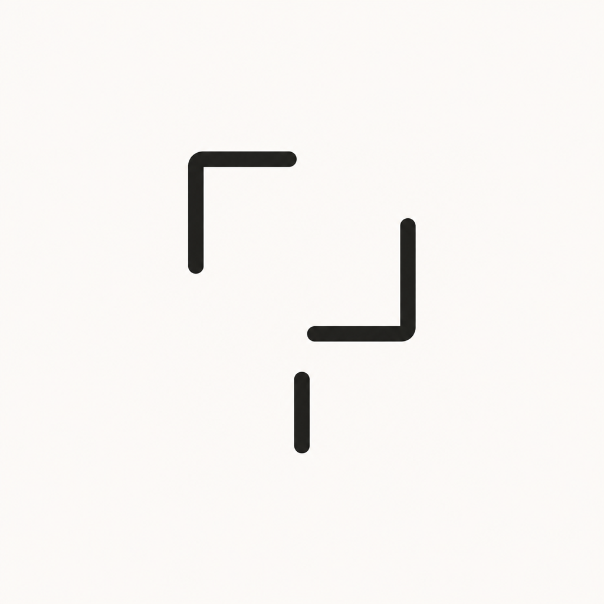
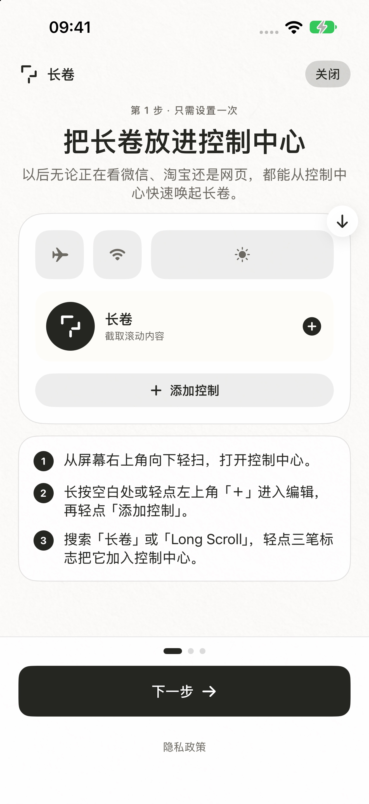
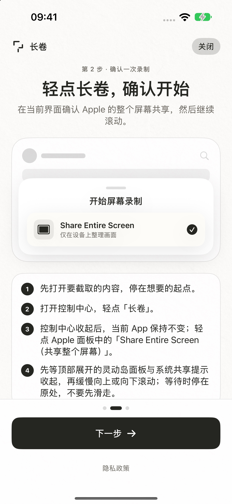
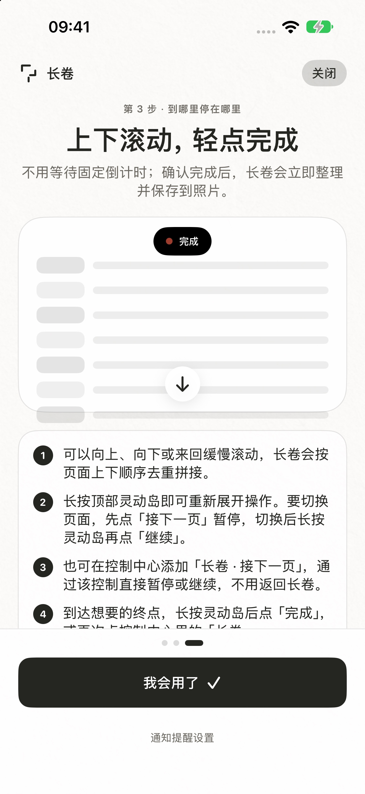
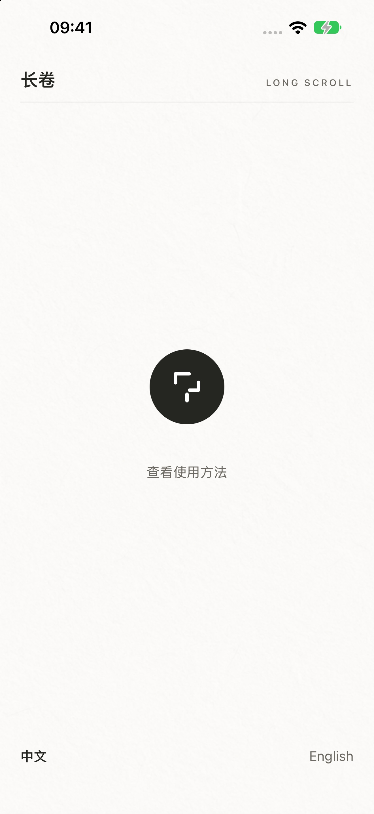
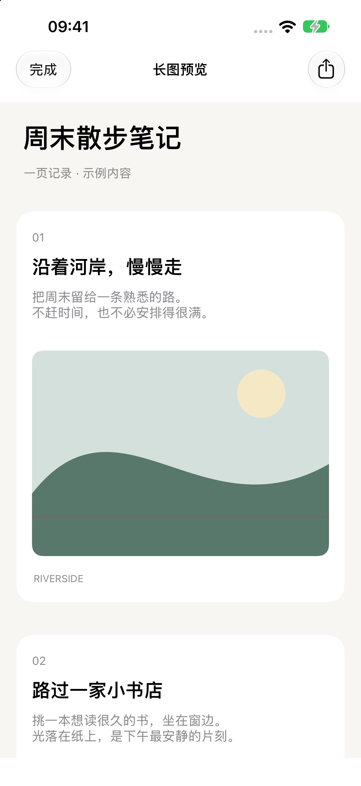

<p align="center">
  
</p>

<h1 align="center">长卷（LongShot）</h1>

<p align="center"><b>完全在 iPhone 本机运行的长截图工具。</b><br>
控制中心一键开始，滚动即录，结束后自动去重、拼接并保存到照片——支持纵横双向滚动与手动跨页接续。</p>

<p align="center">
  
  
  
  
</p>

<p align="center"><b>简体中文</b> · App 内支持中文 / English 界面切换</p>

> [!NOTE]
> **App Store Connect 于 2026-10-23 确认 1.1.3（Build 46）可分发；1.1.4（Build 47）正在准备提交。** 本次加入 Duo 布局和采集几何分段，验证范围见 [Build 47 记录](Tests/Validation-1.1.4-build47-release.md)。

---

## 截图

<p align="center">
  
  
  
  
  
</p>

## 功能亮点

| | |
|---|---|
| 🎛️ **控制中心一键开始** | 从控制中心或操作按钮启动，不跳转 App；系统确认后直接在目标 App 中滚动。 |
| ↕️ **纵横双向滚动** | 设置中选择纵向或横向，支持往返滚动，按方向自动去重拼接；横向适配宽表格。 |
| 📑 **手动跨页接续** | 灵动岛或控制中心「长卷 · 接下一页」暂停 → 切换页面 → 继续，各段按顺序连接并以细分隔带区分。 |
| ⚡ **录制中提前分析** | 采集时即预处理画面，结束后无固定等待，立即拼接保存。 |
| 🖼️ **完成即预览** | 保存到照片后浮出可点击缩略图；允许通知时可收到带缩略图的完成提醒。 |
| 📱 **可选保留状态栏** | 无法可靠识别目标状态栏边界时保留完整画面，避免误裁正文；暂不自动移除侧边状态栏。 |
| 🧹 **本地存储管理** | 保存成功后自动清理原始帧与分析缓存；设置中可手动「清理所有缓存」。 |
| 🔒 **纯本地、隐私优先** | 基于 ScreenCaptureKit，所有帧与输出仅写入本机 App Group 容器，不录音频/相机，不上传服务器。 |

## 快速上手

### 首次设置

1. 打开控制中心进入编辑状态，轻点「添加控制」，搜索并添加「长卷」。
2. （可选）有操作按钮的 iPhone：「设置 → 操作按钮 → 控制」中选择「长卷」。
3. 打开长卷时允许完成提醒；也可在「查看使用方法」第 3 步进入通知设置。

> iOS 不允许 App 自动添加控制，需用户手动设置一次。也可直接打开 App 轻点首页中央图标开始。

### 日常使用

1. 在目标 App 停在起点，打开控制中心轻点「长卷」，确认 Apple 的「共享整个屏幕」。
2. 等顶部面板收起后，沿设置的方向**缓慢**滚动，保持相邻画面有重叠。
3. 需要跨页时：长按灵动岛 →「接下一页」→ 切换页面 → 再长按 →「继续」。**不要在未暂停时直接跨页。**
4. 到达终点后，长按灵动岛点「完成」，或再次轻点控制中心「长卷」；结果自动保存到照片。

## 构建

| 项目 | 要求 |
|---|---|
| Xcode | Xcode 27.1（Build 27A9275） |
| SDK | iOS 27.1 SDK |
| 最低系统 | iOS 27.0（主 App 与所有扩展统一） |
| Swift | 5.0 |

用 Xcode 27.1 打开 `LongShot.xcodeproj`，选择 `LongShot` scheme 与目标 iPhone 运行。默认启用编译条件 `LONGSHOT_SCREEN_CAPTURE_KIT`。

固定回归（需已启动的 iOS 27 模拟器）：

```bash
node Tests/check-release-regressions.mjs --simulator <模拟器 UDID>
```

完整案例与发布门槛见 [固定回归清单](Tests/Regression-checklist.md)。

## 项目结构

```text
LongShotApp/        主 App（SwiftUI 界面、录制协调、拼接 FrameStitcher）
LongScrollWidgets/  控制中心控制与实时活动（灵动岛）
Shared/             共享逻辑：重叠估计、帧管线、存储、本地化（zh-Hans / en）
Tests/              回归检查脚本与各版本验证记录
AppStore/           商店文案、隐私政策、支持页、截图与提交清单
Config/             xcconfig 与导出配置
```

> `BroadcastUpload/`、`BroadcastSetupUI/` 为已移除的 ReplayKit 扩展旧源码，未被工程引用，仅作历史保留。

## 路线图 / 待验收

- [x] iOS 27 专用路线：控制中心开始不跳 App、立即结束、快速整理
- [x] 纵横双向滚动、手动跨页、可选保留状态栏
- [x] 录制期间提前分析与本地存储自动清理（1.1.2）
- [x] 1.1.2（Build 42）公开发布
- [x] 1.1.3（Build 46）App Store 可分发
- [ ] 1.1.4（Build 47）App Store 审核
- [ ] 横持屏幕、极窄表格、大片空白及复杂冻结区域的横向真机验收
- [ ] 不同外观下共享面板遮挡检测效果的真机确认

## 当前边界

- 针对同一屏幕方向、有连续重叠内容的**单轴**滚动优化；不支持横竖混合或斜向拼图。旋转/展开导致采集尺寸或方向改变时分开保存原尺寸结果，不推断跨重排的连续性。
- 采集要求目标 App 全屏；长卷自身可见且占部分显示区域时明确拒绝并排采集，保留原始录制。
- 快速跳跃、动画、视频、自动轮播、重复纹理及双列商品流可能影响匹配；从未清晰出现过的内容无法恢复。
- Apple 的系统共享确认无法被第三方 App 跳过；iOS 系统截图悬浮缩略图不向第三方开放。
- 固定在顶部/底部的导航栏会从拼接主体中裁掉，首尾保留少量上下文。

## 隐私

录制仅在用户明确操作后开始，iOS 全程显示录制状态。长卷不保存麦克风、App 音频或相机内容，不使用服务器。详见 [隐私政策](AppStore/privacy-policy-zh-Hans.md)。

## 许可证

<!-- TODO: 仓库中暂无 LICENSE 文件，待作者确定许可证后补充。 -->
仓库暂未附带许可证文件。
